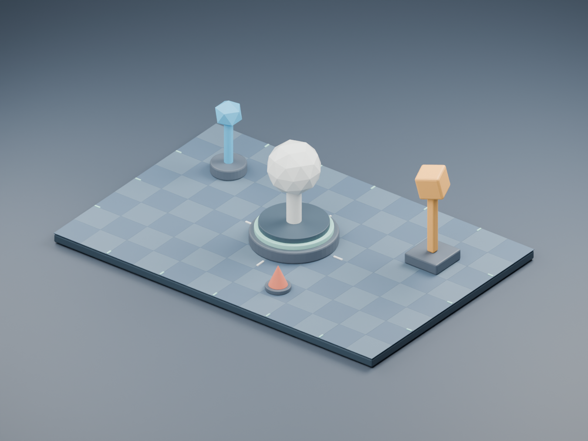

# Camera Blocking Stage

Use this small scene to check a camera pan, orbit, push-in, or framing change without loading a character. The 6 × 4 metre floor uses half-metre tiles, with marks at one-metre intervals. Aim at the white centre target and watch the blue post, amber cube, and low coral cone to see which way the camera moves.

- [**Download GLB**](https://raw.githubusercontent.com/kruqond/renderoverse-3d-assets/main/camera-blocking-stage/camera-blocking-stage.glb): Import the scene in a glTF-compatible editor. It has no external textures, cameras, lights, or animation.
- [**Download the Blender project**](https://raw.githubusercontent.com/kruqond/renderoverse-3d-assets/main/camera-blocking-stage/camera-blocking-stage.blend): The stage meshes are in the exported-geometry collection. The separate studio camera and lights are for preview rendering.

The stage is stationary by design. A camera move should change the framing, not the objects. For a VMD file, [MMD Motion Checker](https://huggingface.co/spaces/zuraxe/mmd-motion-checker) can tell you whether it contains camera keys before you import it.

More PMX and 3D resources are available in the [Renderoverse 3D catalog](https://renderoverse.com/models/3d).

The GLB reimported at the expected scale in Blender 5.2.1 and passed Khronos glTF validation with no errors or warnings.
