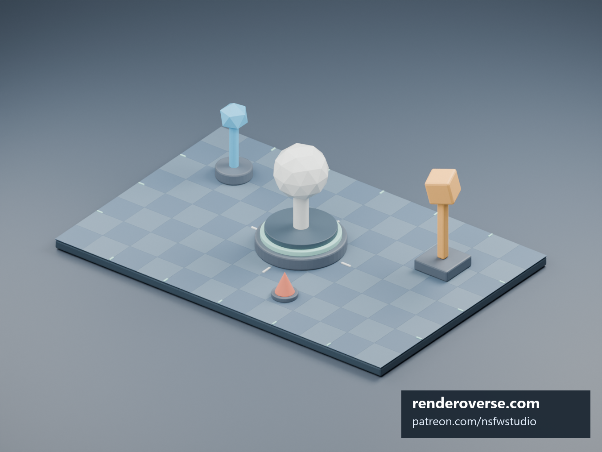

# Camera Blocking Stage

Use this small scene to check a camera pan, orbit, push-in, or framing change without loading a character.

- [**Download GLB**](https://raw.githubusercontent.com/kruqond/renderoverse-3d-assets/main/camera-blocking-stage/camera-blocking-stage.glb): Import the scene in a glTF-compatible editor. It has no external textures, cameras, lights, or animation.
- [**Download the Blender project**](https://raw.githubusercontent.com/kruqond/renderoverse-3d-assets/main/camera-blocking-stage/camera-blocking-stage.blend): The stage meshes are in the exported-geometry collection. The separate studio camera and lights are for preview rendering.

Find more Blender and PMX models in the [Renderoverse 3D catalog](https://renderoverse.com/models/3d), or follow [NSFWstudio on Patreon](https://www.patreon.com/nsfwstudio) for character releases.



The 6 × 4 metre floor uses half-metre tiles, with marks at one-metre intervals. Aim at the white centre target and watch the blue post, amber cube, and low coral cone to see which way the camera moves.

The stage is stationary by design. A camera move should change the framing, not the objects. For a VMD file, [MMD Motion Checker](https://huggingface.co/spaces/zuraxe/mmd-motion-checker) can tell you whether it contains camera keys before you import it.

## Blender Asset Browser

To drop just the stage into an existing scene, add the following URL as an online library in Blender 5.2 or later under **Preferences → Asset Libraries**:

```text
https://raw.githubusercontent.com/kruqond/renderoverse-3d-assets/main/blender-asset-library/
```

In the Asset Browser, choose **Renderoverse Studio Assets → Animation → Camera**, then download and append **Camera Blocking Stage**. This collection has no studio lights, camera, external textures, or scripts. See Blender's [online library instructions](https://docs.blender.org/manual/en/5.2/editors/preferences/asset_libraries.html) if you haven't added one before.

The GLB reimported at the expected scale in Blender 5.2.1 and passed Khronos glTF validation with no errors or warnings.
